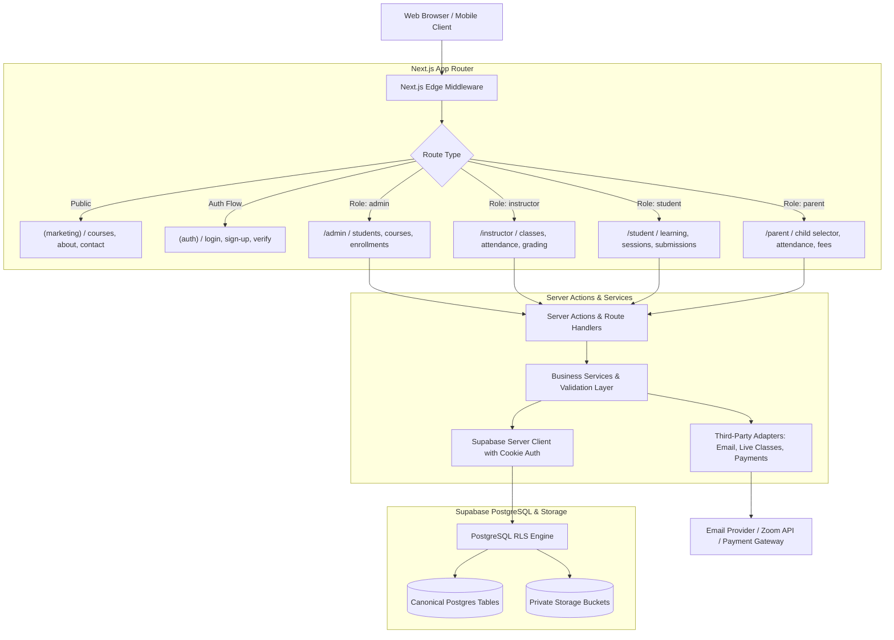

# Syntaxora — System Architecture Document

This document defines the technical architecture, security boundaries, authentication/authorization model, and data flow for the **Syntaxora AI Learning Academy** platform.

---

## 1. Architectural Principles

1. **Unified Application Architecture**: The public marketing website and all four authenticated role portals (`admin`, `instructor`, `student`, `parent`) reside within a single Next.js App Router application. They share the same design system, database, authentication provider, and authorization rules.
2. **Canonical Data Truth**: There is exactly one canonical record for every user profile, student record, course, enrollment, class session, and payment.
3. **Defense in Depth**:
   - Client-side navigation guards (UI ergonomics only).
   - Middleware session verification and edge role routing.
   - Server Component / Server Action authorization checks (validating actor session and permissions).
   - Database PostgreSQL Row Level Security (RLS) enforcing isolation at the query execution level.
4. **Zero-Trust Family Isolation**: Parents/guardians are never granted access to student records by matching names, emails, or phone numbers. All guardian access flows through an explicit, verified `guardian_student_relationships` record with fine-grained permission flags.
5. **No Secrets in Client Code**: All privileged operations, provider keys, and service-role calls occur strictly on the server.

---

## 2. System Topology



---

## 3. Application Boundaries & Routing

The Next.js App Router is organized into distinct route groups and role prefixes:

| Path Prefix | Intended Audience | Protection Mechanism |
|---|---|---|
| `/(marketing)/*` | Public visitors, prospective students & parents | Public access. Static + ISR where applicable. Dynamic catalog queries. |
| `/(auth)/*` | Unauthenticated users or users completing auth flows | Redirects signed-in users to their respective portal based on verified role. |
| `/admin/*` | Verified Academy Administrators | Server-side role check: `role === 'admin'`. Default deny. |
| `/instructor/*` | Academy Instructors | Server-side role check: `role === 'instructor'`. Access scoped to assigned batches/courses. |
| `/student/*` | Enrolled Students | Server-side role check: `role === 'student'`. Access scoped to active enrollments. |
| `/parent/*` | Verified Parents / Legal Guardians | Server-side role check: `role === 'parent'`. Access strictly filtered by `guardian_student_relationships`. |
| `/api/*` | Webhooks and utility endpoints | Webhooks require cryptographic signature verification. Utility endpoints require authenticated session. |

---

## 4. Authentication and Role Resolution

### 4.1 Identity Flow
1. **User Authentication**: Handled by Supabase Auth using secure HTTP-only cookies managed via `@supabase/ssr`.
2. **Profile & Role Synchronization**:
   - When a user signs up via Supabase Auth, a database trigger automatically initializes a corresponding row in `public.profiles`.
   - The authoritative role (`admin`, `instructor`, `student`, `parent`) is stored in the database.
   - Public sign-up forms permit only `student` and `parent` self-selection. Any attempt to supply `admin` or `instructor` role is rejected by server-side validation.
   - `admin` accounts are provisioned via server-side bootstrap; `instructor` accounts are provisioned via admin invitation.

### 4.2 Role Redirection Pipeline
When a user signs in, the server derives their role from `public.profiles`:
- `admin` -> `/admin`
- `instructor` -> `/instructor`
- `student` -> `/student`
- `parent` -> `/parent`

If a user tries to access a portal outside their authorized role, the request is redirected with an access denied response.

---

## 5. Guardian-Student Relationship Architecture

### 5.1 Invariant Rules
- **No Automatic Linking**: A guardian is never connected to a student based on matching surnames, email domains, home addresses, or phone numbers.
- **Explicit Invitation & Verification**: Linking requires a cryptographically generated high-entropy invitation token, bound to a specific student ID and intended recipient.
- **Audited Lifecycle**: Transitions (`pending` -> `active` / `rejected` / `revoked` / `expired`) are transactional, logged to `audit_logs`, and immediately revoke or grant access.

### 5.2 Granular Permission Flags
Every active relationship carries independent permission flags:
- `can_view_attendance`: Controls visibility of session attendance records.
- `can_view_progress`: Controls visibility of completed lessons, modules, and released grades.
- `can_view_schedule`: Controls visibility of upcoming live sessions and class schedules.
- `can_view_fees`: Controls visibility of invoices, billing orders, and payment statuses.
- `can_receive_notifications`: Controls delivery of student updates to the guardian.

### 5.3 Server-Derived Child Selector
In the Parent Portal, switching between children does not trust a client-supplied ID. The server verifies that the authenticated user possesses an `active` relationship with the requested `student_id` before querying child data.

---

## 6. Data Access & Row Level Security (RLS)

All tables have RLS enabled with default deny. Client-side queries use the user's authenticated JWT session.

- **Admin Policy**: Full read/write access to institutional records, with actions recorded in `audit_logs`.
- **Instructor Policy**: Read/write access strictly bounded by `instructor_assignments` (assigned courses, batches, and enrolled students).
- **Student Policy**: Read access restricted to `auth.uid() = profile_id`, active course enrollments, and published lessons. Write access limited to their own assignment submissions.
- **Parent Policy**: Read access strictly bounded by:
  ```sql
  EXISTS (
    SELECT 1 FROM guardian_student_relationships gsr
    WHERE gsr.guardian_profile_id = auth.uid()
      AND gsr.student_id = <target_student_id>
      AND gsr.status = 'active'
      AND gsr.<permission_column> = true
  )
  ```

---

## 7. Third-Party Integrations & Adapter Pattern

All external services are decoupled behind clear TypeScript service interfaces with honest status reporting:

1. **Email Service Adapter** (`src/server/integrations/email/`):
   - Supports SMTP / Resend / SendGrid via environment configuration.
   - Graceful fallback: If API keys are missing, operations log locally and report "Email integration not configured" without failing transactions or pretending messages were sent.
2. **Live-Class Adapter** (`src/server/integrations/meeting/`):
   - Adapters for Zoom API or Google Meet.
   - If unconfigured, admins are notified and fake meeting URLs are never generated.
3. **Payment Service Adapter** (`src/server/integrations/payments/`):
   - Order creation and webhook handling with cryptographic HMAC signature verification.
   - Idempotent event processing prevents duplicate credits or enrollments.
   - Displays clear "Payment gateway not configured" state when keys are absent.
4. **File Storage** (`src/server/integrations/storage/`):
   - Private Supabase Storage buckets for homework submissions, assessments, and invoices.
   - Access governed by short-lived signed URLs (15-minute expiration) generated after server permission checks.

---

## 8. Error Handling, Logging, and Observability

- **Structured Server Logging**: Server actions and API routes log errors with correlation IDs, actor ID, and action names. Sensitive user inputs (passwords, tokens, payment numbers) are sanitized out.
- **Error Boundaries**: User-friendly error fallbacks with recovery actions in `error.tsx` for all route segments.
- **Audit Trail**: High-stakes mutations (guardian linking, grade changes, attendance corrections, role modifications, payment status updates) write immutable records to `public.audit_logs`.
