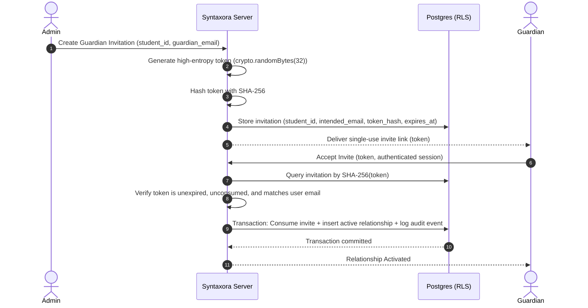

# Syntaxora — Security, Access Control & Privacy Specification

This document defines the security architecture, threat model, authorization matrix, Row Level Security (RLS) policies, and data protection practices for the **Syntaxora AI Learning Academy** platform.

---

## 1. Threat Model & Security Principles

Syntaxora handles educational progress, attendance, and guardian relationships involving minors. Security is built into the architecture rather than patched on top:

1. **Principle of Least Privilege**: Users and roles possess only the absolute minimum permissions required for their pedagogical or administrative function.
2. **Explicit Verification Over Inference**: Family relationships are never inferred from matching email domains, phone numbers, or surnames.
3. **No Secrets in Client Code**: All privileged credentials (`SUPABASE_SERVICE_ROLE_KEY`, email provider keys, payment secret keys, webhook secrets) remain strictly server-side.
4. **Defense in Depth**: Every request is guarded at three distinct boundaries:
   - Edge Middleware session validation.
   - Server Action / Service Layer parameter validation and authorization.
   - Database Row Level Security (RLS) default-deny policies.

---

## 2. Role-Based Access Matrix

| Entity / Resource | Admin | Instructor | Student | Parent / Guardian |
|---|---|---|---|---|
| **Users / Profiles** | Read All, Update Permitted | Read Own + Assigned Students | Read Own | Read Own |
| **Academy Students** | Create, Read, Update, Archive | Read Assigned Enrolled Students | Read Own Student Record | Read Explicitly Linked Children Only |
| **Guardian Links** | Create Invite, Verify, Revoke | None | None | Accept Invite (Own Only) |
| **Courses & Modules** | Create, Edit, Publish | Read Assigned Courses | Read Published / Enrolled | Read Published / Child-Enrolled |
| **Class Sessions** | Schedule, Reschedule, Cancel | Manage Assigned Sessions | View Enrolled Upcoming | View Child-Enrolled Upcoming (if permitted) |
| **Attendance** | Full View & Audited Corrections | Record & Correct Assigned Batches | View Own Attendance | View Child Attendance (if `can_view_attendance`) |
| **Assignments** | Create, Edit, Grade | Create, Edit, Grade Assigned | View Enrolled & Submit Own | View Child Assignments (if `can_view_progress`) |
| **Grades & Feedback** | Manage & Release | Enter & Release Assigned Grades | View Released Own Grades | View Released Child Grades (if `can_view_progress`) |
| **Progress Metrics** | View Platform Aggregate | View Assigned Cohort Progress | View Own Progress | View Child Progress (if `can_view_progress`) |
| **Payments / Invoices** | View Real Payment Records | None | View Own Invoices | View Linked Child Invoices (if `can_view_fees`) |
| **Audit Logs** | Full Read & Filter | None | None | None |

---

## 3. Server-Controlled Role Assignment

### 3.1 Sign-Up Restrictions
- The public registration endpoint (`/sign-up`) permits users to register only as `student` or `parent`.
- Any client attempt to inject `role: "admin"` or `role: "instructor"` is intercepted and rejected by server-side Zod validation.

### 3.2 Administrative Bootstrap
- The root administrator account is provisioned via an authorized server-side CLI or database script. No public "claim admin" endpoint exists.
- Instructors are provisioned solely through the Admin Portal via a secure invitation workflow.

---

## 4. Guardian–Student Relationship Authorization Pipeline



### 4.1 Granular Permissions Verification
Before any child record is returned to a parent:
1. The server identifies `auth.uid()` from the verified session cookie.
2. The server verifies `status = 'active'` in `guardian_student_relationships` for `(auth.uid(), target_student_id)`.
3. The specific permission column (`can_view_attendance`, `can_view_progress`, `can_view_schedule`, `can_view_fees`) is verified as `true`.
4. If any check fails, access is denied with a `403 Forbidden` response.

---

## 5. Row Level Security (RLS) Policies

Every table in the `public` schema has `ENABLE ROW LEVEL SECURITY` turned on. The default action is **DENY**.

### 5.1 Profiles Table
```sql
ALTER TABLE public.profiles ENABLE ROW LEVEL SECURITY;

CREATE POLICY "Users can view own profile"
    ON public.profiles FOR SELECT
    TO authenticated
    USING (auth.uid() = id);

CREATE POLICY "Admins can view all profiles"
    ON public.profiles FOR SELECT
    TO authenticated
    USING ((SELECT role FROM public.profiles WHERE id = auth.uid()) = 'admin');

CREATE POLICY "Users can update own non-role fields"
    ON public.profiles FOR UPDATE
    TO authenticated
    USING (auth.uid() = id)
    WITH CHECK (auth.uid() = id);
```

### 5.2 Students Table
```sql
ALTER TABLE public.students ENABLE ROW LEVEL SECURITY;

CREATE POLICY "Admins have full access to students"
    ON public.students FOR ALL
    TO authenticated
    USING ((SELECT role FROM public.profiles WHERE id = auth.uid()) = 'admin');

CREATE POLICY "Students can view own record"
    ON public.students FOR SELECT
    TO authenticated
    USING (profile_id = auth.uid());

CREATE POLICY "Guardians can view linked active children"
    ON public.students FOR SELECT
    TO authenticated
    USING (
        EXISTS (
            SELECT 1 FROM public.guardian_student_relationships gsr
            WHERE gsr.guardian_profile_id = auth.uid()
              AND gsr.student_id = public.students.id
              AND gsr.status = 'active'
        )
    );
```

### 5.3 Attendance Records Table
```sql
ALTER TABLE public.attendance_records ENABLE ROW LEVEL SECURITY;

CREATE POLICY "Admins view all attendance"
    ON public.attendance_records FOR SELECT
    TO authenticated
    USING ((SELECT role FROM public.profiles WHERE id = auth.uid()) = 'admin');

CREATE POLICY "Instructors manage assigned sessions"
    ON public.attendance_records FOR ALL
    TO authenticated
    USING (
        EXISTS (
            SELECT 1 FROM public.class_sessions cs
            WHERE cs.id = public.attendance_records.class_session_id
              AND cs.instructor_profile_id = auth.uid()
        )
    );

CREATE POLICY "Students view own attendance"
    ON public.attendance_records FOR SELECT
    TO authenticated
    USING (
        EXISTS (
            SELECT 1 FROM public.students s
            WHERE s.id = public.attendance_records.student_id
              AND s.profile_id = auth.uid()
        )
    );

CREATE POLICY "Guardians view child attendance if permitted"
    ON public.attendance_records FOR SELECT
    TO authenticated
    USING (
        EXISTS (
            SELECT 1 FROM public.guardian_student_relationships gsr
            WHERE gsr.guardian_profile_id = auth.uid()
              AND gsr.student_id = public.attendance_records.student_id
              AND gsr.status = 'active'
              AND gsr.can_view_attendance = true
        )
    );
```

---

## 6. Private File Storage & Upload Security

1. **Private Buckets**: Buckets `submissions`, `assessments`, `invoices`, and `documents` have public access disabled.
2. **Access Control**: Downloads require server-generated signed URLs with short lifespans (15 minutes).
3. **Upload Validation**: File uploads are validated server-side for:
   - MIME type and file extension matching.
   - Maximum size limit (e.g., 25MB for assignments).
   - Sanitized, non-enumerable destination path (`/submissions/{student_id}/{assignment_id}/{random_uuid}.pdf`).

---

## 7. Rate Limiting, Spam Protection & CSRF

- Next.js Server Actions enforce CSRF protection natively via origin header validation.
- Sensitive endpoints (login, password reset, guardian invitations, contact forms) enforce IP and account-based rate limiting.
- Contact form submissions use honeypot fields and server-side rate limits to deter automated bots.

---

## 8. Minor Privacy & Indian Data Protection Alignment

- Minimal collection: Date of birth is optional and strictly restricted.
- Zero public exposure: Minor profiles, assignments, progress, and photos are never made publicly visible.
- Account closure & deletion: Deletion requests delete or anonymize personal student data while preserving legally required financial records.
